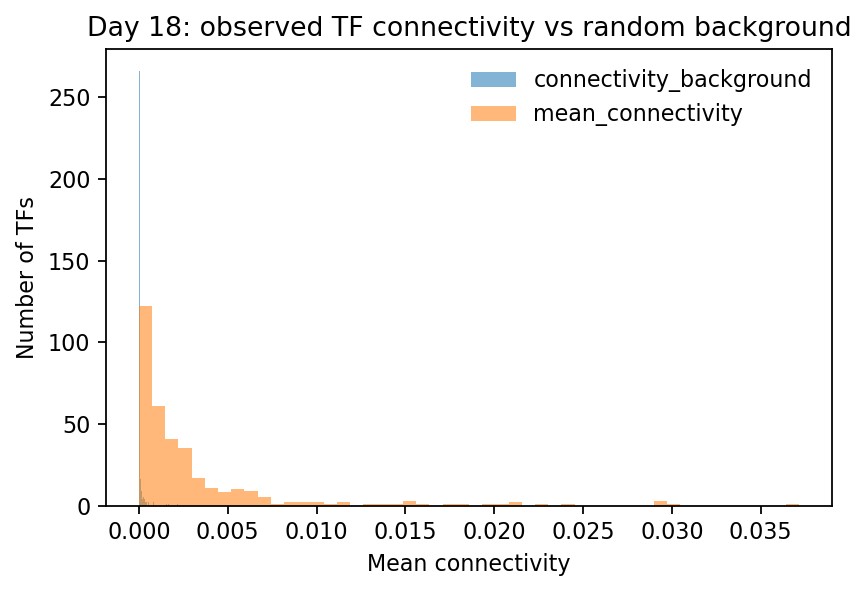
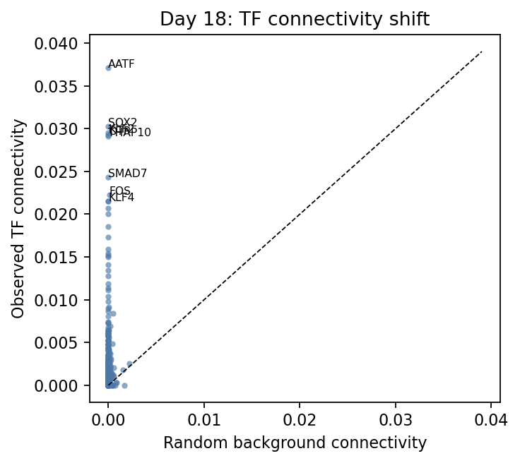
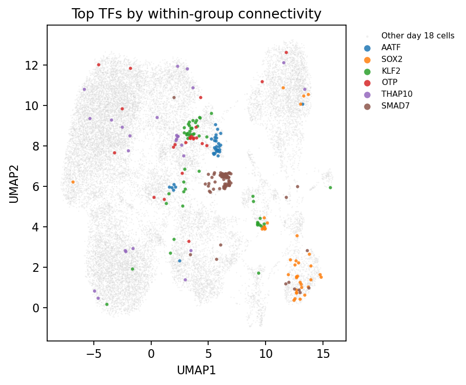
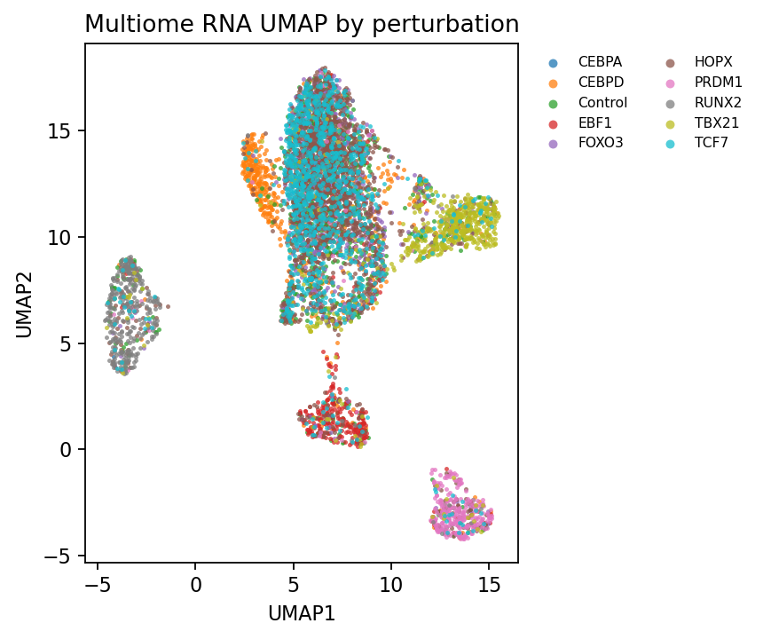
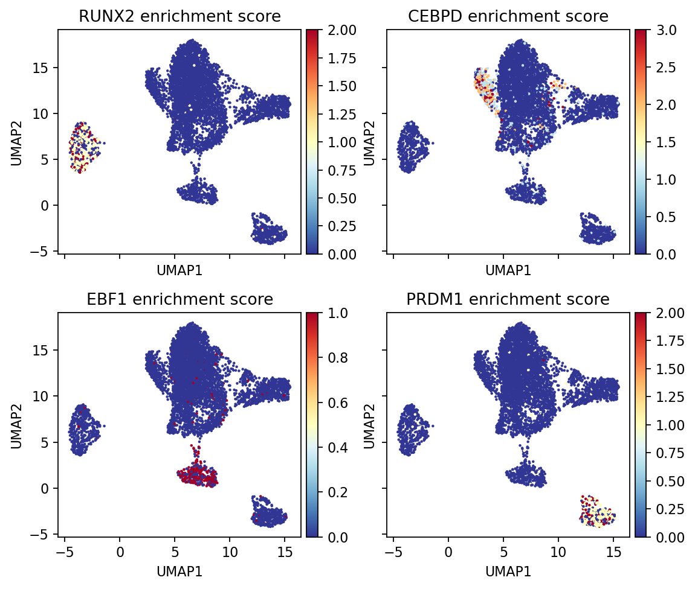
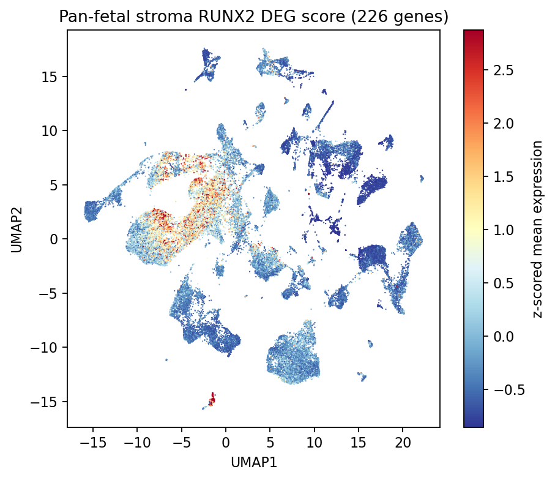
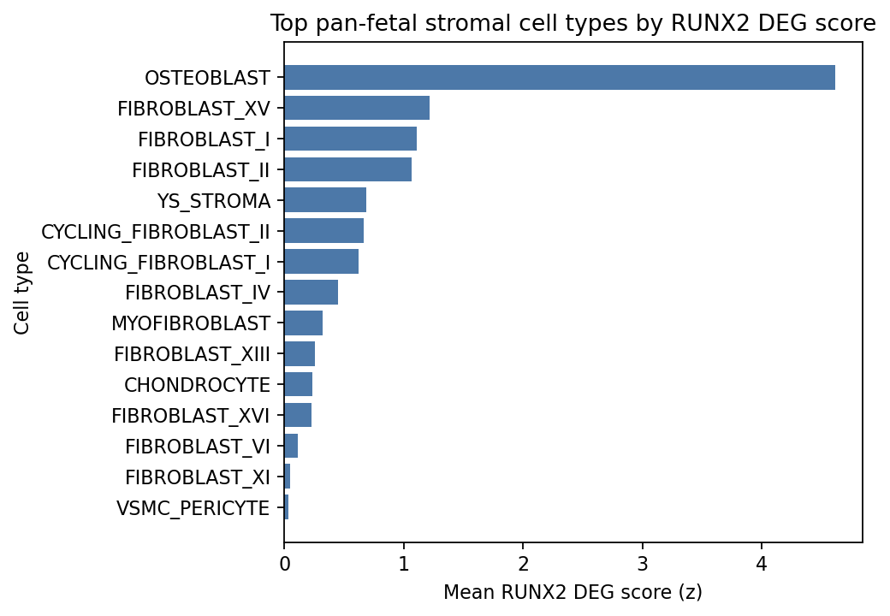

# STEER-seq tutorial

This tutorial demonstrates an end-to-end analysis for a STEER-seq experiment, where a pool of exogenes are overexpressed in cells and each exogene is tagged by a unique barcode sequence that can be recovered by single-cell RNA sequencing.

The workflow is compatible with single-cell RNA-seq experiments using either 3' or 5' chemistries, including 10x Multiome, 10x 3' or 5' sc/snRNA-seq, Parse Biosciences scRNA-seq, and spatial transcriptomics assays, provided the exogene barcode can be captured from the sequencing reads or represented as a countable feature.

The tutorial uses example data objects saved in [`data/`](../data/). For the more detailed manuscript analyses, see the notebooks and scripts under [`code/`](../code/).

## Contents

1. [Barcode identification](#1-barcode-identification)
2. [Identify exogenes with the largest transcriptomic shift](#2-identify-exogenes-with-the-largest-transcriptomic-shift)
3. [Effects of TF perturbation](#3-effects-of-tf-perturbation)
4. [Combine with in vivo atlases](#4-combine-with-in-vivo-atlases)
5. [Integrate with ATAC-seq](#5-integrate-with-atac-seq)

## 1. Barcode Identification

Please refer to the more in-depth write-up [here](../barcode_detection/).

Briefly, if you have your barcodes amplified in a bespoke library, you can make use of Cell Ranger's feature reference quantification. If you have to identify the presence of barcodes from a GEX library, a catch-all solution is the `parse_barcodes.py` script:

```bash
python barcode_detection/parse_barcodes.py \
  --bam possorted_genome_bam.bam \
  --seq barcode_sequences.csv \
  --csv barcode_counts.csv
```

The core logic is to scan each read for a known barcode or its reverse complement, collect cell barcode and UMI tags, and then count unique UMIs per transgene per cell.

It's also possible to identify the presence of barcodes in GEX libraries by inserting exogenous sequences into the reference used for quantification. Best practices for that are detailed in the in-depth instructions.

For the large-scale screen, PacBio reads were used to reconstruct barcode-transgene relationships before generating a Cell Ranger feature reference. The main long-read steps are:

```bash
# Prepare CDS FASTA entries from the 10X reference.
gffread \
  -x ~/transcriptomes+genemaps/GRCh38-2020-A/cdses.fa \
  -g ~/cellranger/GRCh38-2020-A/fasta/genome.fa \
  ~/cellranger/GRCh38-2020-A/genes/genes.gtf

sed "s/ gene=/_/" \
  ~/transcriptomes+genemaps/GRCh38-2020-A/cdses.fa \
  > ~/transcriptomes+genemaps/GRCh38-2020-A/cdses-genenames.fa
```

```bash
# Map PacBio reads to CDS sequences.
~/minimap2/minimap2 \
  -x map-hifi \
  --secondary=no \
  ~/transcriptomes+genemaps/GRCh38-2020-A/cdses-genenames.fa \
  reads.fastq \
  > mapped.paf
```

```python
import pandas as pd

paf = pd.read_table(
    "mapped.paf",
    index_col=0,
    header=None,
    usecols=[0, 2, 3, 4, 5],
    names=["", "start", "end", "orientation", "target"],
)

paf = paf.loc[~paf.index.duplicated(keep=False), :]
paf.to_csv("mapped_cleaned.paf")
```

```bash
python3 barcode_detection/longread/find-barcodes-clean-paf.py reads.fastq mapped_cleaned.paf barcodes.csv
```

The identified barcode-transgene pairs are then converted to a Cell Ranger feature reference, requiring the barcode to be between 10 and 14bp long and the barcode-transgene pair to have more than 10 reads supporting it. Syntax for the feature reference creation can be found [here](../barcode_detection/longread/N09-feature-reference-2.0.ipynb).

### Calling TF barcodes in the pooled TF screen

Source notebook: code/POOL_TF/[`POOL_TF.A01.v02.load_data.ipynb`](../code/POOL_TF/POOL_TF.A01.v02.load_data.ipynb)

After reading the 10x feature-barcode matrix with `gex_only=False`, the exogene barcode counts are stored as `Antibody Capture` features. The pooled TF notebook calls one TF per cell by taking the dominant antibody-capture barcode and then filtering low-confidence calls.

```python
import scanpy as sc
import pandas as pd
import numpy as np
```

```python
adata = sc.read_10x_h5(
    "filtered_feature_bc_matrix.h5",
    gex_only=False,
)
```

```python
gex = np.array(adata.var["feature_types"] == "Gene Expression")
antibody_capture = adata.var_names[
    adata.var["feature_types"] == "Antibody Capture"
]
```

First, inspect how many barcode features are detected per cell above a simple count threshold. The ideal threshold is a trade-off between false positive calling caused by barcode "soup" or ambient RNA, and false negative calling where too few cells have barcodes identified. Barcode counts in ambient RNA can be inspected using code/POOL_TF/[`POOL_TF.A01.v01.load_data_empty_droplet.ipynb`](../code/POOL_TF/POOL_TF.A01.v01.load_data_empty_droplet.ipynb), where a barcode count threshold can be decided.

```python
barcode_counts = adata[:, antibody_capture].X
n_barcodes_per_cell = np.asarray((barcode_counts > 5).sum(axis=1)).ravel()

pct_one_barcode = (
    np.sum(n_barcodes_per_cell == 1) /
    np.sum(n_barcodes_per_cell > 0) *
    100
)

print(f"% cells with only 1 barcode among cells with any barcode: {pct_one_barcode:.2f}%")
```

Next, call the dominant barcode in each cell. The barcode feature names encode the TF identity, so the TF name is extracted from the antibody-capture feature name.

```python
X_barcode = adata[:, antibody_capture].X.tocsr()

row_max = X_barcode.max(axis=1).toarray().ravel()
row_sum = X_barcode.sum(axis=1).A1
dominant_idx = np.asarray(X_barcode.argmax(axis=1)).ravel()

adata.obs["antibody_max_count"] = row_max
adata.obs["antibody_calling"] = antibody_capture[dominant_idx]

with np.errstate(divide="ignore", invalid="ignore"):
    adata.obs["antibody_max_perc"] = np.divide(
        row_max,
        row_sum,
        out=np.zeros_like(row_max, dtype=float),
        where=row_sum != 0,
    )

adata.obs["TF_calling"] = [
    "-".join(barcode.split("-")[:-2])
    for barcode in adata.obs["antibody_calling"]
]
```

Finally, filter low-confidence calls. In the pooled TF notebook, a cell is kept only if the dominant barcode has at least 6 counts and accounts for more than half of the barcode counts in that cell.

```python
cutoff = 6

low_confidence = (
    (adata.obs["antibody_max_count"] < cutoff) |
    (adata.obs["antibody_max_perc"] <= 0.5)
)

adata.obs.loc[low_confidence, "antibody_calling"] = np.nan
adata.obs.loc[low_confidence, "TF_calling"] = np.nan
```

Summarise the number of cells assigned to each TF:

```python
tf_counts = (
    adata.obs["TF_calling"]
    .value_counts(dropna=True)
    .rename_axis("TF_calling")
    .reset_index(name="count")
)

tf_counts.head(20)
```

For downstream transcriptome analysis, keep the gene-expression features after TF calling has been stored in `.obs`.

```python
adata_gex = adata[:, gex].copy()
```

## 2. Identify Exogenes With The Largest Transcriptomic Shift

Source notebook: code/POOL_TF/[`POOL_TF.A03.v03.pool_TF_working.ipynb`](../code/POOL_TF/POOL_TF.A03.v03.pool_TF_working.ipynb)

The key section is `Demonstrate that TF has changed the transcriptome`. The analysis asks whether cells assigned to the same exogenous TF are more connected in the scVI neighbour graph than random cell sets of the same size.

```python
import scanpy as sc
import pandas as pd
import numpy as np
from scipy.stats import mannwhitneyu
import seaborn as sb
import matplotlib.pyplot as plt
```

```python
adata = sc.read("data/pool_scvi_celltypist_v2.h5ad")
```

```python
day_select = 18
adata_select = adata[adata.obs["HSC_days"] == day_select]
```

```python
tf_list = [
    tf
    for tf in adata_select.obs["TF_calling"].cat.categories
    if tf in adata.var_names
]

conn = adata_select.obsp["connectivities"].tocsr()

df_distance = pd.DataFrame(
    index=tf_list,
    columns=["mean_connectivity", "connectivity_background", "n_cells"],
)

for tf in tf_list:
    select = np.array(adata_select.obs["TF_calling"] == tf)
    cells = np.where(select)[0]
    df_distance.loc[tf, "n_cells"] = select.sum()

    if select.sum() > 19:
        subgraph = conn[cells[:, None], cells]
        df_distance.loc[tf, "mean_connectivity"] = subgraph.sum() / (
            len(cells) * (len(cells) - 1)
        )

        random_cells = np.random.choice(
            range(adata_select.shape[0]),
            size=select.sum(),
            replace=False,
        )
        subgraph_bkg = conn[random_cells[:, None], random_cells]
        df_distance.loc[tf, "connectivity_background"] = subgraph_bkg.sum() / (
            len(random_cells) * (len(random_cells) - 1)
        )
```

```python
df_long = (
    df_distance
    .loc[~df_distance["mean_connectivity"].isna(), ["mean_connectivity", "connectivity_background"]]
    .melt(var_name="metric", value_name="value")
)

x = df_long.loc[df_long["metric"] == "mean_connectivity", "value"]
y = df_long.loc[df_long["metric"] == "connectivity_background", "value"]

stat, p = mannwhitneyu(list(x), list(y), alternative="two-sided")
print(f"Mann-Whitney U statistic: {stat}, p-value: {p}")
```

```python
df_distance.sort_values("mean_connectivity", ascending=False).head(20)
```

```python
sb.histplot(
    df_long,
    x="value",
    hue="metric",
    bins=50,
    stat="count",
    common_norm=False,
)
plt.xlabel("Mean connectivity")
plt.ylabel("Number of TFs")
plt.title(f"Day {day_select}")
```

Example output generated from `data/pool_scvi_celltypist_v2.h5ad`:



The observed within-TF connectivity is shifted above the random background:

| day | n_tfs_tested | Mann-Whitney U | p-value | median TF connectivity | median background connectivity |
|--:|--:|--:|--:|--:|--:|
| 18 | 349 | 106397 | 1.04e-71 | 0.00136 | 0.00000 |

The top TFs by observed within-group connectivity are:

| TF | n_cells | mean_connectivity | connectivity_background | connectivity_delta |
|:--|--:|--:|--:|--:|
| AATF | 32 | 0.0372 | 0.0000 | 0.0372 |
| SOX2 | 38 | 0.0303 | 0.0000 | 0.0303 |
| KLF2 | 50 | 0.0296 | 0.0000 | 0.0296 |
| OTP | 23 | 0.0293 | 0.0000 | 0.0293 |
| THAP10 | 26 | 0.0291 | 0.0000 | 0.0291 |
| SMAD7 | 83 | 0.0243 | 0.0000 | 0.0243 |
| FOS | 146 | 0.0223 | 0.0001 | 0.0222 |
| KLF4 | 24 | 0.0215 | 0.0000 | 0.0215 |
| OTX2 | 35 | 0.0215 | 0.0000 | 0.0215 |
| NR4A3 | 47 | 0.0207 | 0.0000 | 0.0207 |



The top connected TF groups occupy local regions of the day 18 UMAP:



## 3. Effects Of TF Perturbation

Source notebook: code/MULTIOME/[`MULTIOME.sample_enrichment.ipynb`](../code/MULTIOME/MULTIOME.sample_enrichment.ipynb)

This notebook samples Milo neighbourhoods and uses chi-square tests to identify parts of the transcriptomic space enriched for each perturbation relative to WT/control cells.

```python
import scanpy as sc
import pandas as pd
import numpy as np
import muon as mu
import pertpy as pt
from scipy.stats import chi2_contingency
```

```python
mdata = mu.read("data/mdata_full.h5mu")
adata = mdata["rna"]
```

```python
sc.pp.neighbors(adata, use_rep="X_pca", n_neighbors=50, random_state=1712)

milo = pt.tl.Milo()
midata = milo.load(adata)
milo.make_nhoods(midata["rna"])
midata = milo.count_nhoods(midata, sample_col="sample_ID")

nhoods = midata["rna"].obsm["nhoods"]
```

```python
df_nhood_zscore = pd.DataFrame(
    index=range(nhoods.shape[1]),
    columns=adata.obs["perturbation"].cat.categories[1:],
)

wt = adata.obs["perturbation"] == "Control"
wt_idx = np.where(wt)[0]
w_total = len(wt_idx)

for smp in df_nhood_zscore.columns:
    condition = adata.obs["perturbation"] == smp
    sample_idx = np.where(condition)[0]
    n_total = len(sample_idx)

    for i in df_nhood_zscore.index:
        nhood_col = nhoods[:, i]
        sample_nhood = nhood_col[sample_idx]
        wt_nhood = nhood_col[wt_idx]

        n_in = sample_nhood.sum()
        w_in = wt_nhood.sum()

        table = np.array([
            [n_in, n_total - n_in],
            [w_in, w_total - w_in],
        ])

        chi2, p, dof, expected = chi2_contingency(table)
        direction = np.sign((n_in / n_total) - (w_in / w_total))
        df_nhood_zscore.loc[i, smp] = direction * np.sqrt(chi2)
```

```python
n_cells, n_nhoods = nhoods.shape
sizes = np.asarray(nhoods.sum(axis=0)).ravel()
inv_sizes = 1.0 / sizes

den_all = nhoods @ inv_sizes

for smp in df_nhood_zscore.columns:
    z = df_nhood_zscore[smp].astype(float).values
    num_all = nhoods @ (z * inv_sizes)

    score_all = np.zeros(n_cells, dtype=float)
    np.divide(num_all, den_all, out=score_all, where=den_all != 0)

    adata.obs[f"nhood_score_{smp}"] = score_all
```

```python
sc.pl.umap(
    adata,
    color=[f"nhood_score_{smp}" for smp in df_nhood_zscore.columns],
    title=df_nhood_zscore.columns,
    frameon=False,
    ncols=4,
)
```

Example output generated from `data/mdata_full.h5mu`:



The perturbation composition in this object is:

| perturbation | n_cells |
|:--|--:|
| HOPX | 1738 |
| TCF7 | 1048 |
| Control | 856 |
| FOXO3 | 576 |
| TBX21 | 576 |
| CEBPD | 486 |
| RUNX2 | 329 |
| PRDM1 | 295 |
| EBF1 | 282 |
| CEBPA | 6 |

The H5MU also stores perturbation score columns, which can be visualised on the same RNA UMAP:



## 4. Combine With In Vivo Atlases

Source notebook: code/MULTIOME/[`DEG_enrichment_panfetal.ipynb`](../code/MULTIOME/DEG_enrichment_panfetal.ipynb)

This notebook scores perturbation DEGs against pan-fetal cell type programs to connect in vitro perturbation effects with in vivo lineage signatures.

```python
import scanpy as sc
import pandas as pd
import numpy as np
import gseapy as gp
```

```python
stroma = sc.read("data/PAN.A01.v01.raw_count.20210429.STROMA.embedding.h5ad")
```

```python
deg = pd.read_csv("data/ipsc_multiome_tf_degs_wilcoxon.csv")

deg = deg.loc[deg["group"] == "RUNX2", :]
deg = deg.loc[
    np.array(deg["pvals_adj"] < 0.05) &
    np.array(deg["logfoldchanges"] > 2),
    :
]

runx2_list = [gene for gene in deg["names"] if gene in stroma.var_names]
```

```python
sc.tl.score_genes(stroma, runx2_list, score_name="runx2")

score_key = "runx2"
group_key = "anno_lvl_2_final_clean"

ordered_groups = (
    stroma.obs
    .groupby(group_key)[score_key]
    .mean()
    .sort_values(ascending=False)
    .index
)

stroma.obs[group_key] = stroma.obs[group_key].cat.reorder_categories(
    list(ordered_groups)
)
```

```python
sc.pl.umap(
    stroma,
    color=["runx2", "anno_lvl_2_final_clean"],
    title=["RUNX2 DEG score", "Cell type"],
    legend_loc="on data",
    legend_fontsize=5,
)

sc.pl.violin(
    stroma,
    keys="runx2",
    groupby="anno_lvl_2_final_clean",
    rotation=90,
    ylabel="RUNX2 DEG score",
)
```

```python
osteo = stroma[stroma.obs["anno_lvl_2_final_clean"] == "OSTEOBLAST"]

sc.pp.normalize_per_cell(osteo, counts_per_cell_after=1e4)
sc.pp.log1p(osteo)
sc.pp.neighbors(osteo, use_rep="X_scvi", random_state=1712)
sc.tl.umap(osteo, random_state=1712)
```

```python
sc.tl.leiden(osteo, resolution=0.5)
sc.tl.rank_genes_groups(osteo, "leiden", method="wilcoxon", use_raw=False)

result = osteo.uns["rank_genes_groups"]
groups = ["0"]

df = pd.DataFrame({
    f"{group}_{key[:1]}": result[key][group]
    for group in groups
    for key in ["names", "pvals_adj", "logfoldchanges"]
})

select = np.array(df["0_p"] < 0.05) & np.array(df["0_l"] > 2)
degs_up = df.loc[select, "0_n"]

enr_up = gp.enrichr(
    degs_up,
    gene_sets="MSigDB_Hallmark_2020",
    outdir=None,
)

enr_up.res2d.head(10)
```

Example output generated from `data/PAN.A01.v01.raw_count.20210429.STROMA.embedding.h5ad` and `data/ipsc_multiome_tf_degs_wilcoxon.csv`:



The highest-scoring pan-fetal stromal cell types are:

| cell_type | n_cells | mean_score | mean_z |
|:--|--:|--:|--:|
| OSTEOBLAST | 1734 | 5.768 | 4.614 |
| FIBROBLAST_XV | 2804 | 2.207 | 1.218 |
| FIBROBLAST_I | 25041 | 2.092 | 1.109 |
| FIBROBLAST_II | 10984 | 2.045 | 1.063 |
| YS_STROMA | 334 | 1.651 | 0.688 |
| CYCLING_FIBROBLAST_II | 7770 | 1.628 | 0.666 |
| CYCLING_FIBROBLAST_I | 7870 | 1.583 | 0.623 |
| FIBROBLAST_IV | 22634 | 1.401 | 0.449 |
| MYOFIBROBLAST | 11238 | 1.267 | 0.322 |
| FIBROBLAST_XIII | 2892 | 1.200 | 0.258 |



CellTypist annotation examples are available in:

- [`SPI1_CONSTITUTIVE.A03.v01.annotation.ipynb`](../code/SPI1_VALIDATION/SPI1_CONSTITUTIVE.A03.v01.annotation.ipynb)
- [`SPI1_INDUCIBLE.A03.v02.annotation.ipynb`](../code/SPI1_VALIDATION/SPI1_INDUCIBLE.A03.v02.annotation.ipynb)

## 5. Integrate With ATAC-seq

Source notebooks:

- code/MULTIOME/004_grn_inference/[`011_eRegulon_dimred.ipynb`](../code/MULTIOME/004_grn_inference/011_eRegulon_dimred.ipynb)
- code/MULTIOME/004_grn_inference/[`012_plot_DARs.ipynb`](../code/MULTIOME/004_grn_inference/012_plot_DARs.ipynb)

### eRegulon dimensionality reduction and network plotting

This section visualises SCENIC+ eRegulon activity, target-region overlap, and perturbation-associated regulatory networks.

```python
import dill
from scenicplus.dimensionality_reduction import (
    run_eRegulons_umap,
    run_eRegulons_tsne,
    plot_eRegulon,
    plot_AUC_given_ax,
)
from scenicplus.plotting.correlation_plot import jaccard_heatmap
from pycisTopic.diff_features import find_highly_variable_features
from scenicplus.networks import create_nx_tables, create_nx_graph, plot_networkx
```

```python
scplus_obj = dill.load(open("scplus_obj_with_regulons.pkl", "rb"))
```

```python
run_eRegulons_umap(
    scplus_obj=scplus_obj,
    auc_key="eRegulon_AUC_filtered",
    reduction_name="eRegulons_UMAP",
)

run_eRegulons_tsne(
    scplus_obj=scplus_obj,
    auc_key="eRegulon_AUC_filtered",
    reduction_name="eRegulons_tSNE",
)
```

```python
selected_eregulons = scplus_obj.uns["selected_eRegulon"]["Gene_based"]

plot_eRegulon(
    scplus_obj=scplus_obj,
    reduction_name="eRegulons_tSNE",
    scale=True,
    auc_key="eRegulon_AUC_filtered",
)
```

```python
plot_AUC_given_ax(
    scplus_obj=scplus_obj,
    reduction_name="eRegulons_tSNE",
    feature="FOSL1_+_+_(62g)",
    auc_key="eRegulon_AUC_filtered",
    signature_key="Gene_based",
)
```

```python
flat_list = lambda t: [item for sublist in t for item in sublist]

selected_markers = list(set(flat_list([
    scplus_obj.uns["RSS"]["GEX_perturbation_filtered"]
    .loc[celltype]
    .sort_values(ascending=False)
    .head(10)
    .index
    .to_list()
    for celltype in scplus_obj.uns["RSS"]["GEX_perturbation_filtered"].index
])))
```

```python
region_intersect_data, Z = jaccard_heatmap(
    scplus_obj,
    method="intersect",
    gene_or_region_based="Region_based",
    use_plotly=False,
    selected_regulons=selected_markers,
    signature_key="eRegulon_signatures",
    return_data=True,
    vmax=1,
    cmap="plasma",
)
```

```python
hvr = find_highly_variable_features(
    scplus_obj.to_df("ACC").loc[
        list(set(scplus_obj.uns["eRegulon_metadata"]["Region"]))
    ],
    n_top_features=500,
    plot=False,
)

hvg = find_highly_variable_features(
    scplus_obj.to_df("EXP")[
        list(set(scplus_obj.uns["eRegulon_metadata"]["Gene"]))
    ].T,
    n_top_features=400,
    plot=False,
)
```

```python
nx_tables = create_nx_tables(
    scplus_obj=scplus_obj,
    eRegulon_metadata_key="eRegulon_metadata",
    subset_eRegulons=["RUNX2", "BACH2", "ZEB1", "NFE2L2", "POU5F1"],
    subset_regions=hvr,
    subset_genes=hvg,
    add_differential_gene_expression=True,
    add_differential_region_accessibility=True,
    differential_variable=["GEX_perturbation"],
)

G, pos, edge_tables, node_tables = create_nx_graph(
    nx_tables,
    use_edge_tables=["TF2R", "R2G"],
)

plot_networkx(G, pos)
```

### Differentially accessible regions and DEG/GRN integration

This section links DARs with high-confidence GRN triplets and DEGs.

```python
import pandas as pd
import numpy as np
import matplotlib.pyplot as plt
from adjustText import adjust_text
```

```python
dars = pd.read_csv("archr_DARs_perturbation_df_pos_neg.txt", sep="\t")
grns = pd.read_csv("eregulon_metadata_full_20runs_combined_min5recall.csv", index_col=0)
degs = pd.read_csv("ipsc_multiome_tf_degs_wilcoxon.csv")
```

```python
dar_grn = dars.merge(
    grns,
    left_on="peak",
    right_on="Region",
    how="left",
)
```

```python
degs_renamed = degs.rename(columns={
    "group": "Cell_type",
    "names": "Gene",
    "logfoldchanges": "deg_logFC",
    "pvals_adj": "deg_FDR",
    "scores": "deg_score",
    "pvals": "deg_pval",
})

dar_grn_deg = dar_grn.merge(
    degs_renamed,
    on=["Cell_type", "Gene"],
    how="left",
)
```

```python
cell_types = ["RUNX2"]
dar_fdr_cutoff = 0.05
deg_fdr_cutoff = 0.05

plot_df = dar_grn_deg[dar_grn_deg["Cell_type"].isin(cell_types)].copy()
plot_df["neg_log10_FDR"] = -np.log10(plot_df["FDR"].clip(lower=1e-300))
plot_df["neg_log10_deg_FDR"] = -np.log10(plot_df["deg_FDR"].clip(lower=1e-300))

plot_df["point_colour"] = "grey"
plot_df.loc[
    (plot_df["FDR"] < dar_fdr_cutoff) &
    (plot_df["deg_FDR"] < deg_fdr_cutoff) &
    (plot_df["deg_logFC"] > 0),
    "point_colour",
] = "darkred"
plot_df.loc[
    (plot_df["FDR"] < dar_fdr_cutoff) &
    (plot_df["deg_FDR"] < deg_fdr_cutoff) &
    (plot_df["deg_logFC"] < 0),
    "point_colour",
] = "darkblue"
```

```python
fig, ax = plt.subplots()

ax.scatter(
    plot_df["Log2FC"],
    plot_df["neg_log10_FDR"],
    c=plot_df["point_colour"],
    alpha=0.7,
)

ax.axhline(-np.log10(dar_fdr_cutoff), color="black", linestyle="--", linewidth=0.8)
ax.axvline(0, color="black", linewidth=0.8)
ax.set_xlabel("DAR log2FC")
ax.set_ylabel("-log10(DAR FDR)")

label_df = plot_df.sort_values("neg_log10_FDR", ascending=False).head(6)
texts = [
    ax.text(row["Log2FC"], row["neg_log10_FDR"], row["Gene"])
    for _, row in label_df.iterrows()
]
adjust_text(texts, ax=ax)
```

```python
dar_grn_deg.to_csv("DAR_DEG_GRN.csv")
```

## Basic Requirements

The notebooks expect the processed STEER-seq analysis objects and reference files used in the project analysis. Update file paths before running the code in a new environment.

The main Python analysis stack includes `scanpy`, `pandas`, `numpy`, `muon`, `pertpy`, `scipy`, `gseapy`, `matplotlib`, `adjustText`, and SCENIC+/pycisTopic dependencies for the ATAC-seq and GRN sections.
